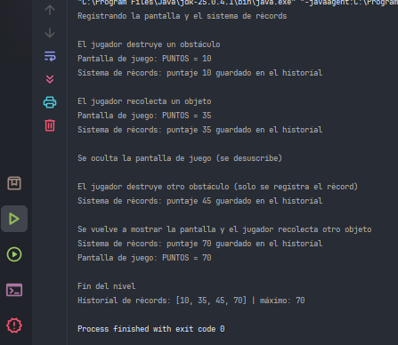

# Ejercicio 03 - Marcador de Puntuación para Videojuego Sencillo

## Descripción

Un videojuego arcade en consola necesita mostrar la puntuación acumulada del jugador en la pantalla principal y en un registro histórico de récords, cada vez que el jugador suma puntos.

## Objetivos

- Canalizar eventos de cambio de puntuación hacia varios receptores independientes.
- Mantener la lógica del juego libre de llamadas a pantalla y a persistencia.
- Permitir suscribir y desuscribir componentes durante la ejecución.

## Implementación del patrón Observer

Se usa la variante clásica, donde el sujeto envía el valor numérico actualizado.

- **Sujeto:** `GameScore` acumula el total y notifica en cada `addPoints`.
- **Observador:** `ScoreObserver` declara `onScoreChanged(int score)`.
- **Observadores concretos:** `GameScreen` muestra los puntos y `RecordsSystem` los guarda en un historial.
- **Lógica del juego:** `Game` solo suma puntos al destruir un obstáculo o recolectar un objeto, sin conocer pantalla ni récords.
- **Suscripción dinámica:** `Game` ofrece métodos para agregar y quitar oyentes en cualquier momento.

## Propósito de la clase

- `ScoreObserver`: interfaz común de los oyentes.
- `GameScore`: puntuación acumulada y sujeto observable.
- `Game`: lógica del juego.
- `GameScreen`: pantalla principal en consola.
- `RecordsSystem`: historial de récords.
- `Main`: simula la partida, oculta y vuelve a mostrar la pantalla, y muestra el historial.

## Concepto clave

La lógica de puntuación solo avisa que el puntaje cambió. Qué se hace con ese dato (mostrarlo, guardarlo) lo deciden los observadores.

## Resultado

## Conclusión

El patrón Observer permite que un mismo cambio llegue de forma ordenada a varios destinos. El juego queda libre de dependencias de pantalla y persistencia, y se pueden sumar nuevos componentes sin tocar su lógica.
